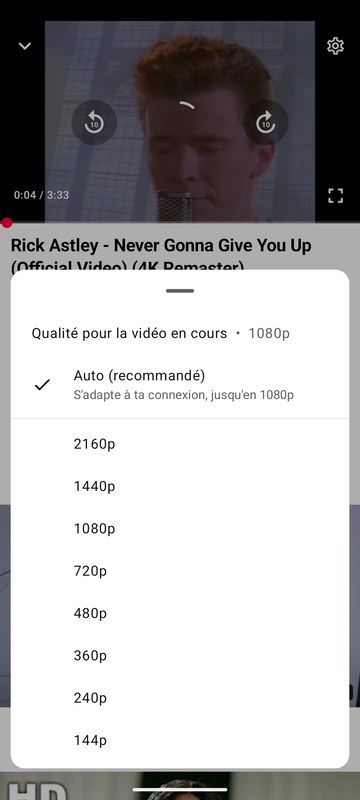
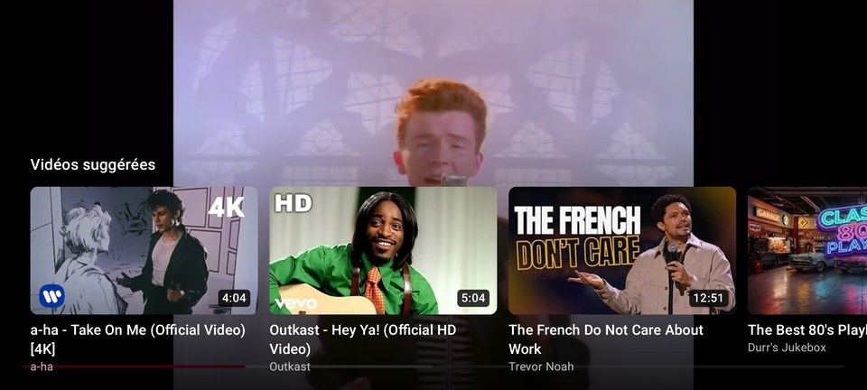

<div align="center">


# SigmaTube

**Un client YouTube pour Android, sans pub, rapide et propre.**
L'interface que tu connais, sans tout le reste.

[](https://github.com/antmrlt/sigmatube/actions/workflows/build.yml)


[**Télécharger l'APK**](https://github.com/antmrlt/sigmatube/releases/latest) · [Fonctionnalités](#fonctionnalités) · [Installation](#installation) · [Compiler](#compiler-le-projet)

</div>

<br />

<p align="center">
  
  
  
  
</p>

---

## Fonctionnalités

### 🎬 Lecture
- **Aucune publicité**, aucun tracking
- Lecteur sur mesure : double-tap pour avancer/reculer de 10 s, barre de progression précise
- **Qualité au choix** de 144p à 2160p, vitesse de lecture, lecture en boucle
- **Plein écran** en glissant la vidéo vers le haut ; vidéos suggérées en glissant encore vers le haut
- **Mini-lecteur flottant** : glisse la vidéo vers le bas, déplace-la dans un des 4 coins, jette-la hors de l'écran pour la fermer

### 🧭 Navigation
- Accueil par catégories (**Musique, Jeux vidéo, Films, Podcasts**) sans lives
- Recherche avec suggestions instantanées et défilement infini
- Pages chaînes, description et **commentaires** en panneaux qui laissent la vidéo visible
- Ouvre les liens YouTube partagés depuis n'importe quelle app

### 👤 Compte (optionnel)
- Connexion à ton compte Google via la page officielle de Google
- **Fil d'accueil personnalisé** et **flux de tes abonnements**
- **J'aime / Je n'aime pas** synchronisés avec ton compte

<table>
  <tr>
    <td align="center"><br /><sub>Recherche</sub></td>
    <td align="center"><br /><sub>Qualité vidéo</sub></td>
    <td align="center"><br /><sub>Icône de l'app</sub></td>
  </tr>
</table>

<p align="center">
  <br />
  <sub>Plein écran : glisse vers le haut pour afficher les suggestions</sub>
</p>

---

## Installation

1. Va dans [**Releases**](https://github.com/antmrlt/sigmatube/releases/latest) et télécharge `SigmaTube.apk`
2. Ouvre le fichier sur ton téléphone et autorise l'installation depuis cette source si Android le demande
3. C'est tout. Les nouvelles versions s'installent par-dessus l'ancienne.

> Chaque push sur `main` produit aussi un APK téléchargeable dans l'onglet [**Actions**](https://github.com/antmrlt/sigmatube/actions) (section *Artifacts* du dernier build).

---

## Compiler le projet

**Prérequis :** Android Studio (ou JDK 17+ et le SDK Android 36).

```sh
git clone https://github.com/antmrlt/sigmatube.git
cd sigmatube
./gradlew :app:assembleDebug
```

L'APK se trouve dans `app/build/outputs/apk/debug/app-debug.apk`.
Pour l'installer directement sur un téléphone branché : `./gradlew :app:installDebug`.

### Publier une version

```sh
git tag v0.2.0
git push origin v0.2.0
```

GitHub Actions compile l'APK et crée la Release automatiquement.

---

## Architecture

```
app/src/main/java/app/sigmatube/
├── data/
│   ├── YouTubeRepository.kt   # vidéos, recherche, chaînes, commentaires (NewPipeExtractor)
│   ├── auth/                  # session Google + client InnerTube (fil perso, abonnements, likes)
│   └── extractor/             # pont HTTP OkHttp ↔ NewPipe
├── player/PlayerManager.kt    # ExoPlayer unique pour toute l'app
├── ui/
│   ├── watch/                 # lecteur, mini-lecteur flottant, panneaux, paramètres
│   ├── home/  search/  channel/  library/  account/
│   ├── components/            # cartes vidéo, états de chargement/erreur
│   ├── navigation/            # routes + barre de navigation
│   └── theme/
└── util/Format.kt             # formatage FR (vues, durées, dates relatives)
```

| Brique | Choix |
|---|---|
| UI | Jetpack Compose, Material 3 |
| Données | [NewPipeExtractor](https://github.com/TeamNewPipe/NewPipeExtractor) (extraction locale, aucune API tierce) |
| Lecture | Media3 / ExoPlayer |
| Images | Coil 3 |
| Réseau | OkHttp |

---

## Confidentialité

- Sans compte, rien n'est envoyé ailleurs qu'aux serveurs de YouTube, sans identifiant.
- Avec un compte, l'app ne voit **jamais** ton mot de passe : la connexion se fait sur la page de Google, et seuls les cookies de session sont conservés, dans le stockage privé de l'app (sauvegarde Android désactivée).
- Se déconnecter (onglet **Vous**) efface la session.

> ⚠️ Utiliser son compte depuis un client non officiel est contraire aux conditions d'utilisation de YouTube. Le risque est faible mais existe : utilise un compte secondaire si tu préfères ne prendre aucun risque.

---

## Avertissement

SigmaTube est un projet indépendant, **non affilié à YouTube ni à Google**. YouTube est une marque de Google LLC.

## Licence

Distribué sous licence **GPLv3**, comme NewPipeExtractor sur lequel il s'appuie.
